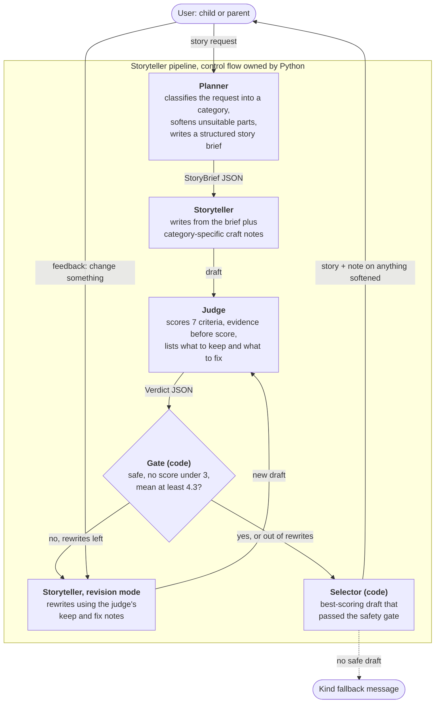

# Bedtime Storyteller

Hippocratic AI take-home. Turns any story request into a bedtime story for ages 5 to 10,
using a planner, a storyteller and an LLM judge that sends weak drafts back for a rewrite.

Model: **Claude Haiku 5.5** (`claude-haiku-5-5`) for every call, as instructed in the
assignment email, in place of GPT-3.5 Turbo.

## Run it

```bash
pip install -r requirements.txt
```

```bash
export ANTHROPIC_API_KEY=...
```

```bash
python main.py
```

Or pass the request directly, and see what the judge thought:

```bash
python main.py "A story about a girl named Alice and her best friend Bob, who happens to be a cat." --minutes 4 --verbose
```

| Flag | Meaning |
|---|---|
| `--minutes 2-10` | Read-aloud length (default 5, at about 130 words per minute) |
| `--revisions N` | Maximum judge-driven rewrites per story (default 2) |
| `-v, --verbose` | Show progress, the judge's scores and its evidence |

After the story, type a change ("make Bob a dragon", "shorter", "more jokes") and it is
rewritten and judged again. Press Enter to finish.

Tests run offline against a scripted fake model:

```bash
python -m unittest discover -s tests -t .
```

## How it works



Three prompts, one model, and all decisions in code:

1. **Planner** (`PLANNER_SYSTEM`). Reads the raw request and returns a `StoryBrief`:
   a category, the details that must survive, a wish, a gentle obstacle, five beats and a
   refrain. If part of the request is not right for bedtime it does not refuse; it keeps
   the spirit and swaps in a gentle equivalent, and records the swap so the grown-up is
   told. The request is treated as a wish, never as instructions.
2. **Storyteller** (`STORYTELLER_SYSTEM`). Writes from the brief. The category selects
   one of seven craft notes (adventure, friendship, funny, cozy, mystery, curiosity,
   comfort), so a silly story and a story for a child who is nervous about the doctor are
   written differently.
3. **Judge** (`JUDGE_SYSTEM`). A separate persona with a rubric: safety, age fit, story
   arc, delight, read-aloud quality, bedtime landing and request fit. It writes evidence
   before each score, and returns concrete fixes plus what to keep.
4. **Gate and selector** (`bedtime/pipeline.py`). Python decides, not the model. A story
   is only shown if safety is 5 and age fit is at least 4. It stops early when the mean
   reaches 4.3 with no score under 3; otherwise the storyteller rewrites with the judge's
   notes, up to `--revisions` times. Because a rewrite can come out worse, the
   best-scoring safe draft wins, not the latest. If no draft is safe, the user gets a
   kind "let's try another idea" message.
5. **Feedback loop**. A requested change goes to the storyteller as a wish and the result
   goes through the same judge and gate. If no safe version of the change exists, the
   listener keeps the story they already had.

## Design choices

- **One shared picture of the listener.** All three prompts open with the same
  description of a child in bed being read to, and each rule is tied to that picture.
  The judge therefore grades against the same standard the storyteller wrote to.
- **Energy falls toward sleep.** A bedtime story has a job that other stories do not:
  the last third slows down and ends sleepy. This is written into the planner's beats,
  the storyteller's craft rules and a dedicated judge criterion.
- **Soften, don't refuse.** A five-year-old asking for a monster fight should get a
  story, so the planner reframes and tells the parent what it changed.
- **A comfort category.** Requests that reveal a real worry (a hospital visit, the dark,
  a new school) get craft notes built around being noticed, one small brave step and
  relief, with no promises real life cannot keep and no medical advice.
- **Structured hand-offs.** The brief and the verdict are Pydantic models enforced by the
  API's structured outputs, so no free text is parsed.
- **The judge advises, code decides.** Thresholds, the hard safety gate and best-draft
  selection live in Python where they can be tested and changed without touching a prompt.
- **No temperature.** Claude Haiku 5.5 rejects non-default sampling parameters, so the
  skeleton's `temperature=0.1` is gone and variety is asked for in the prompts.

## Layout

| File | Purpose |
|---|---|
| `main.py` | CLI and the feedback loop |
| `bedtime/prompts.py` | Every prompt and prompt builder |
| `bedtime/schemas.py` | `StoryBrief`, `Verdict` and the pass rules |
| `bedtime/pipeline.py` | Plan, write, judge, revise, select |
| `bedtime/llm.py` | Anthropic SDK wrapper (the only file that touches the network) |
| `tests/test_pipeline.py` | Offline tests of the control flow |

The API key is read from `ANTHROPIC_API_KEY` and is never stored in the repository.
