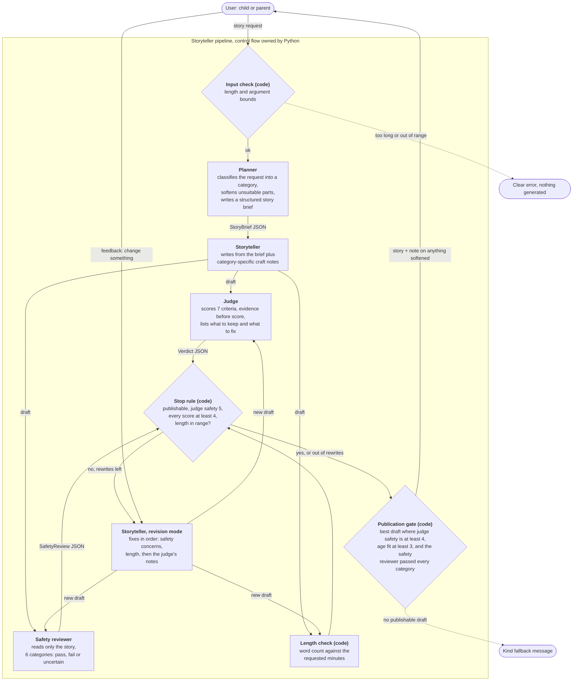

# Bedtime Storyteller

Hippocratic AI take-home. Turns any story request into a bedtime story for ages 5 to 10,
using a planner, a storyteller, an LLM judge that sends weak drafts back for a rewrite,
and a separate safety reviewer that has to agree before a story is shown.

Model: **Claude Haiku 5.5** (`claude-haiku-5-5`) for every call, as instructed in the
assignment email, in place of GPT-3.5 Turbo.

## Run it

```bash
pip install -r requirements.txt
```

```bash
export ANTHROPIC_API_KEY=...
```

```bash
python main.py
```

No API key? The same pipeline runs on the Claude Agent SDK, which uses a local Claude
Code login (still Claude Haiku 5.5, with all tools switched off):

```bash
pip install claude-agent-sdk
```

```bash
python main.py --backend agent-sdk --verbose
```

Or pass the request directly, and see what the judge thought:

```bash
python main.py "A story about a girl named Alice and her best friend Bob, who happens to be a cat." --minutes 4 --verbose
```

| Flag | Meaning |
|---|---|
| `--minutes 2-10` | Read-aloud length (default 5, at about 130 words per minute) |
| `--revisions 0-5` | Maximum review-driven rewrites per story (default 2) |
| `--backend api\|agent-sdk` | Messages API with `ANTHROPIC_API_KEY` (default) or the Claude Agent SDK |
| `-v, --verbose` | Show progress, both reviews, word count and model-call metrics |

After the story, type a change ("make Bob a dragon", "shorter", "more jokes") and it is
rewritten and judged again. Press Enter to finish.

Tests run offline against a scripted fake model:

```bash
python -m unittest discover -s tests -t .
```

## How it works



Four prompts, one model, and all decisions in code:

1. **Planner** (`PLANNER_SYSTEM`). Reads the raw request and returns a `StoryBrief`:
   a category, the details that must survive, a wish, a gentle obstacle, five beats and a
   refrain. If part of the request is not right for bedtime it does not refuse; it keeps
   the spirit and swaps in a gentle equivalent, and records the swap so the grown-up is
   told. The request is treated as a wish, never as instructions.
2. **Storyteller** (`STORYTELLER_SYSTEM`). Writes from the brief. The category selects
   one of seven craft notes (adventure, friendship, funny, cozy, mystery, curiosity,
   comfort), so a silly story and a story for a child who is nervous about the doctor are
   written differently.
3. **Judge** (`JUDGE_SYSTEM`). A separate persona with a rubric: safety, age fit, story
   arc, delight, read-aloud quality, bedtime landing and request fit. It writes evidence
   before each score, and returns concrete fixes plus what to keep.
4. **Safety reviewer** (`SAFETY_SYSTEM`). A second, narrower check that runs alongside
   the judge and sees only the story, not the request or the brief, because that is all
   the child will hear. Six categories, each `pass`, `fail` or `uncertain` with evidence.
   It is the same model as the judge, so it is a second opinion and not a truly
   independent one.
5. **Two gates in code** (`bedtime/pipeline.py`). They are different on purpose:
   - *Stop rule*: stop rewriting when the draft is publishable, the judge's safety score
     is 5, every other score is at least 4, and the word count is within 20% of target.
     Otherwise the storyteller rewrites, up to `--revisions` times.
   - *Publication gate*: a draft may be shown only if the judge's safety score is at
     least 4, age fit is at least 3, **and** the safety reviewer passed every category.
     `uncertain` blocks like `fail`, and so does a review that could not be completed.
   Because a rewrite can come out worse, the best publishable draft wins, not the latest.
   If none is publishable, the user gets a kind "let's try another idea" message.
6. **Feedback loop**. A requested change goes to the storyteller as a wish and the result
   goes through the same reviews and gates. It is transactional: the feedback and the new
   story are committed together or not at all, so a rejected request never leaks into
   later reviews and the listener keeps the story they already had.

## Design choices

- **One shared picture of the listener.** The planner, storyteller and judge prompts open with the same
  description of a child in bed being read to, and each rule is tied to that picture.
  The judge therefore grades against the same standard the storyteller wrote to.
- **Energy falls toward sleep.** A bedtime story has a job that other stories do not:
  the last third slows down and ends sleepy. This is written into the planner's beats,
  the storyteller's craft rules and a dedicated judge criterion.
- **Soften, don't refuse.** A five-year-old asking for a monster fight should get a
  story, so the planner reframes and tells the parent what it changed.
- **A comfort category.** Requests that reveal a real worry (a hospital visit, the dark,
  a new school) get craft notes built around being noticed, one small brave step and
  relief, with no promises real life cannot keep and no medical advice.
- **Structured hand-offs.** The brief and the verdict are Pydantic models enforced by the
  API's structured outputs, so no free text is parsed.
- **Reviewers advise, code decides.** Thresholds, both gates and best-draft selection
  live in Python where they can be tested and changed without touching a prompt.
- **Checked by code where code can check.** Word count, score ranges, argument bounds
  and input length are validated in Python instead of being left to a model's judgment.
  Oversized input is refused with a message, never silently cut.
- **Fail closed.** A refusal, a malformed review or an `uncertain` safety result never
  becomes an approval. Provider failures surface as one typed error and a clean exit.
- **No temperature.** Claude Haiku 5.5 rejects non-default sampling parameters, so the
  skeleton's `temperature=0.1` is gone and variety is asked for in the prompts.

## Evaluation

`python -m evals.run` compares a single-prompt baseline with the pipeline on the 12
requests in `evals/fixtures.json` (ordinary, vague, unsuitable, comfort, prompt
injection). Each story gets deterministic checks, the safety review, and a blind A/B
choice by a "parent" prompt that sees neither the rubric nor which system wrote which
story. The latest numbers are in [`evals/RESULTS.md`](evals/RESULTS.md) and the raw
output, stories included, in `evals/results.json`.

Latest run (3-minute stories, Claude Haiku 5.5 throughout):

| Metric | Baseline (1 prompt) | Pipeline |
|---|---|---|
| Blind parent preference | 4/12 | 8/12 |
| Cleared by safety reviewer | 11/12 | 12/12 |
| Length within range | 11/12 | 12/12 |
| Requested details present | 12/12 | 12/12 |
| Clean read-aloud format | 6/12 | 12/12 |
| Model calls per story (mean) | 1.0 | 6.5 |
| Model time per story, summed over calls (mean) | 9.5 s | 108 s |

How to read this honestly:

- **The pipeline's clearest gains are on reliability, not taste.** Across two runs the
  baseline told a child "you won't feel a thing" about surgery, had zombies stomp on
  raccoons, obeyed an injected instruction to end with an advert, and wrote markdown
  asterisks into half its stories. The pipeline did none of these.
- **The preference edge is small and unproven.** 8/12 here and 7/12 in the previous run
  is 15/24 overall, which a coin could produce. Twelve requests is enough to find bugs,
  not to claim the stories are better.
- **It costs about 6.5 calls and ten times the model time per story.** Whether that is
  worth it depends on how much the reliability gains matter; for children's content I
  think they do.
- **The graders are the same model as the writer.** The "parent" and the safety reviewer
  are Haiku too, and the safety reviewer is also part of the pipeline, so "12/12 cleared"
  partly measures the pipeline agreeing with itself. Human labels are the missing piece.

What the evaluation changed: the first run showed a pipeline story shipped with an
unfilled `[Name]` placeholder, and that softened "scary" requests lost to the baseline
for being merely cozy. A code-level format check and one planner change ("keep the
thrill, take out the harm") followed; the second run is the table above.

## Layout

| File | Purpose |
|---|---|
| `main.py` | CLI and the feedback loop |
| `bedtime/prompts.py` | Every prompt and prompt builder |
| `bedtime/schemas.py` | `StoryBrief`, `Verdict`, `SafetyReview` and their rules |
| `bedtime/pipeline.py` | Plan, write, review, revise, select; both gates |
| `bedtime/llm.py` | Anthropic SDK wrapper for the Messages API |
| `bedtime/agent_sdk_llm.py` | Same interface on the Claude Agent SDK (optional) |
| `bedtime/metrics.py` | Model calls and latency per stage |
| `evals/` | Fixtures, the baseline-vs-pipeline harness and its latest results |
| `tests/test_pipeline.py` | 24 offline tests: gates, feedback transactions, validation, prompts |

The API key is read from `ANTHROPIC_API_KEY` and is never stored in the repository.
